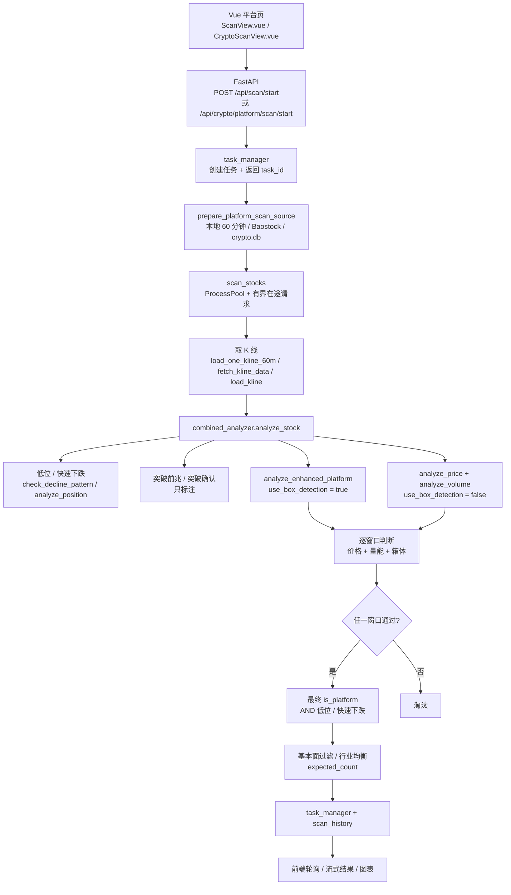
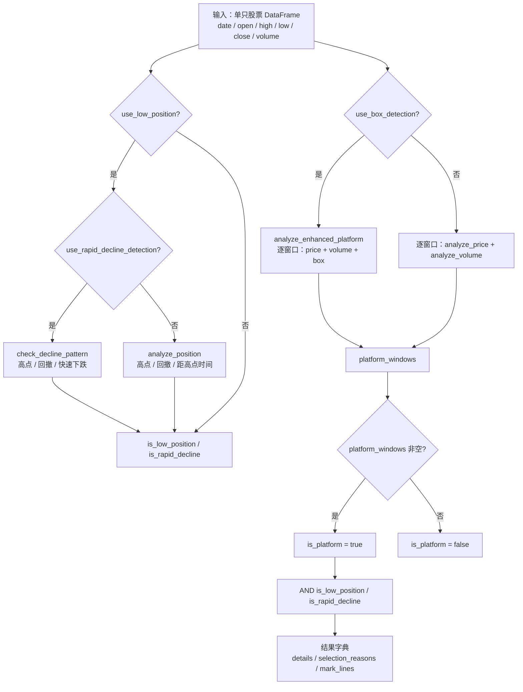

# 平台算法调用图与 main/develop 差异

> 范围：平台-A / 平台-U（平台期扫描），不是横盘扫描。
> 当前工作区：`main`；对照分支：`origin/develop`。
> 生成日期：2026-11-04。
> 完整算法补丁：`docs/platform_main_vs_develop.diff`。

---

## 1. 总调用链



关键点：

- `scan_stocks` 是并发与取消的边界；`analyze_stock` 是单只股票的全部判定。
- `platform_windows` 是“通过平台的窗口列表”，窗口之间是 OR。
- 低位/快速下跌是平台之后的 AND；突破只是标注，不改变 `is_platform`。

---

## 2. 单只股票判定流程



---

## 3. 函数级调用表

| 层 | 函数 | 文件 | 作用 |
|---|---|---|---|
| API | `start_scan` / `_run_scan` | `api/index.py` | 创建任务、后台执行、写历史 |
| 数据源 | `prepare_platform_scan_source` | `api/platform_scan_source.py` | 本地 60 分钟 / Baostock 分流 |
| 扫描 | `scan_stocks` | `api/platform_scanner.py` | 股票池、进程池、进度、取消、后处理 |
| 单股组合 | `analyze_stock` | `api/analyzers/combined_analyzer.py` | 低位、突破、平台、窗口合并 |
| 价格 | `calculate_price_features` / `check_price_pattern` | `api/analyzers/price_analyzer.py` | box_range / ma_diff / volatility |
| 量能 | `calculate_volume_features` / `check_volume_pattern` | `api/analyzers/volume_analyzer.py` | 量比、量稳、缩量条件 |
| 箱体 | `identify_support_resistance` / `check_box_pattern` | `api/analyzers/box_detector.py` | 支撑阻力、箱体质量 |
| 增强平台 | `check_enhanced_platform` / `analyze_enhanced_platform` | `api/analyzers/enhanced_platform_analyzer.py` | 逐窗口组合 price + volume + box |
| 低位 | `analyze_position` | `api/analyzers/position_analyzer.py` | 高点回撤 + 距高点时间 |
| 回撤/快速下跌 | `analyze_decline_speed` / `check_decline_pattern` | `api/analyzers/decline_analyzer.py` | 回撤幅度、快速下跌窗口 |
| 突破 | `analyze_breakthrough` / `check_breakthrough_confirmation` | `api/analyzers/breakthrough_analyzer.py` | MACD/RSI/KDJ/布林带 + 站稳确认 |
| 窗口权重 | `apply_window_weights` | `api/analyzers/window_weight_analyzer.py` | 加权得分，不参与筛选 |
| 基本面 | `analyze_fundamentals` | `api/analyzers/fundamental_analyzer.py` | 行业百分位过滤，扫描后执行 |
| 行业均衡 | `apply_industry_diversity_filter` | `api/industry_filter.py` | 结果过多时按行业分配名额 |
| 加密 | `analyze_crypto_platform` | `api/crypto/platform_scan.py` | 复用 `analyze_stock`，按类别给阈值 |

---

## 4. 关键数据结构

### 4.1 `details[w]`

每个窗口一份，由 `check_enhanced_platform` 生成：

```text
{
  "window": 60,
  "box_range": 0.0891,
  "box_threshold": 0.10,
  "ma_diff": 0.0097,
  "ma_diff_threshold": 0.02,
  "volatility": 0.0111,
  "volatility_threshold": 0.02,
  "status": "符合平台期条件" / "价格区间过大" / "均线发散" / "箱体质量不足" / ...,
  "volume_analysis": {
      "window": 60,
      "volume_change_ratio": 0.3698,
      "volume_stability": 0.2521,
      "status": "符合条件"
  },
  "box_analysis": {
      "support_levels": [...],
      "resistance_levels": [...],
      "box_quality": 0.9667,
      "is_box_pattern": true,
      "status": "符合箱体条件"
  }
}
```

### 4.2 结果字段

```text
is_platform           最终是否入选
platform_windows      通过平台的窗口，如 [20, 30]
details               每个窗口的指标和失败原因
selection_reasons     每个窗口的人类可读理由
platform_judgment_log 判定过程日志
volume_analysis       按窗口的量能结果
box_analysis          代表性窗口的箱体结果（用于画支撑/阻力）
mark_lines            高点、快速下跌起止、支撑/阻力线
is_low_position       低位判断
is_rapid_decline      快速下跌判断
position_details      低位明细
decline_details       回撤/快速下跌明细
breakthrough_prediction / has_breakthrough_confirmation  突破标注
weighted_score        窗口加权得分
```

`scan_stocks` 再包装成 `platform_stock`，加入 `code / name / industry / kline_data` 后交给任务系统和前端。

---

## 5. main vs develop 算法差异

### 5.1 总表

| 文件 | main | develop | 影响 |
|---|---|---|---|
| `box_detector.py` | 内部固定 `is_box_pattern = quality >= 0.6`；`check_box_pattern` 再叠加用户阈值 | 内部不再固定 0.6；`check_box_pattern` 直接检查支撑/阻力存在 + 用户阈值 + 波动率，并回写最终 `is_box_pattern` | 箱体门槛从 `max(0.6, 用户阈值)` 变成“用户阈值唯一决定”；`box_quality` 不再四舍五入 |
| `combined_analyzer.py` | 启用箱体时，额外用最大窗口 `analyze_box_pattern` 做二次否决 | 删除二次否决；只取通过窗口的箱体结果做标注 | 长窗口箱体质量不再能否决短窗口已通过的平台 |
| `decline_analyzer.py` | `len(df) < 60` 才判数据不足 | `len(df) < max(60, lookback_days)` | 默认 365 根时，少于 365 根直接 `insufficient_data`；360 根日线会全部失败 |
| `decline_analyzer.py` | 天数差用 `.days`（整数） | 用 `total_seconds()/86400`（小数） | 边界日附近判定更细 |
| `decline_analyzer.py` | 明细键 `decline_days / daily_decline_rate` | 改为 `decline_bars / decline_rate_per_bar` | 消费方需要适配字段名 |
| `position_analyzer.py` | `len(df) < 30`；距高点用行数 | `len(df) < max(30, lookback_days)`；距高点用日历天 | 低位口径更严格、更符合“天数”语义 |
| `enhanced_platform_analyzer.py` | 理由写“N日平台期” | 写“N根K线平台期” | 只影响文案 |
| `platform_scanner.py` | 60 分钟只检查 `len(df) < max_window` | 用 `prepare_scan_frame`：已收盘、连续、精确锚点、缺口检测、eligible windows | 数据质量更严格，停牌/缺口/未收盘 bar 不再混入 |
| `crypto/platform_router.py` | 较少 limit/history/streaming 处理 | 增加 limit_count、历史、流式结果 | 任务层变化，不改分析公式 |
| `crypto/platform_scan.py` | — | 未变 | 仍复用 `combined_analyzer.analyze_stock` |
| `price_analyzer.py` / `volume_analyzer.py` | — | 未变 | 价格和量能公式一致 |

### 5.2 `box_detector.py`

main：

```python
# identify_support_resistance
is_box_pattern = box_quality >= 0.6

# check_box_pattern
is_box = (
    analysis.get("is_box_pattern", False) and
    analysis.get("box_quality", 0) >= box_quality_threshold and
    analysis.get("volatility", float("inf")) <= volatility_threshold
)
```

develop：

```python
# identify_support_resistance
is_box_pattern = True  # Structural evidence; the caller applies its quality threshold.

# check_box_pattern
is_box = (
    bool(analysis.get("support_levels")) and bool(analysis.get("resistance_levels")) and
    analysis.get("box_quality", 0) >= box_quality_threshold and
    analysis.get("volatility", float("inf")) <= volatility_threshold
)
analysis["is_box_pattern"] = bool(is_box)
```

影响：

- main 的箱体质量下限是 `max(0.6, box_quality_threshold)`；develop 只看用户阈值。
- develop 明确要求存在支撑位和阻力位，避免 `quality=0` 之类的退化情况被误判。
- main 返回 `round(box_quality, 2)`；develop 返回完整浮点，边界附近的结果可能不同。

### 5.3 `combined_analyzer.py`

main 在平台窗口确定后，还会做一次最大窗口箱体否决：

```python
if use_box_detection:
    max_window = max(windows) if windows else 90
    box_analysis = analyze_box_pattern(df, max_window)
    is_platform = is_platform and box_analysis.get("is_box_pattern", False)
```

develop 删除这段，只保留代表性窗口的箱体结果用于画图/标注：

```python
if use_box_detection and platform_windows:
    representative = max(platform_windows)
    box_analysis_results = details.get(representative, {}).get("box_analysis", {})
```

影响：短窗口通过、长窗口箱体质量不足的股票，main 会被否决，develop 可以通过。

其他变化：

- 理由文案从“N日平台期”改为“N根K线平台期”。
- 移除了 `print(平台期判断过程...)`，但 `platform_judgment_log` 仍保留在结果里。
- 修复了局部变量 `details` 覆盖参数 `details` 的问题，改用 `position_details / decline_details`。
- 突破确认文案从“确认天数”改为“确认根数”。

### 5.4 `decline_analyzer.py`

```python
# main
if len(df) < 60:
    return insufficient_data

# develop
if len(df) < max(60, lookback_days):
    return insufficient_data
```

这是本次实际踩到的坑：develop 默认 `lookback_days=365`，而日线数据只有 360 根，所有股票都会 `insufficient_data`，低位和快速下跌恒为 0。解决方式是把 `high_point_lookback_days` 降到 ≤360（本次用 300），或提供更长的历史。

其他变化：

- `df.sort_values('date').reset_index(drop=True)`。
- 天数差改为 `total_seconds()/86400`。
- 明细键改为 `decline_bars / decline_rate_per_bar`。
- 文档明确：`lookback_days`、`rapid_decline_days` 实际是 K 线根数；`decline_period_days` 是日历天。

### 5.5 `position_analyzer.py`

```python
# main
if df.empty or len(df) < 30:
    return 数据不足
days_since_high = len(df.loc[high_index:])  # 行数

# develop
if df.empty or len(df) < max(30, high_point_lookback_days):
    return 数据不足
days_since_high = (pd.to_datetime(df['date'].iloc[-1])
                   - pd.to_datetime(high_date)).total_seconds() / 86400
```

影响：main 把“距高点多少根”当成“多少天”；develop 改成真实日历天。对日线差别不大，对 60 分钟线差别很大。

### 5.6 `platform_scanner.py` / `data_quality.py`

develop 在 `scan_stocks` 里引入 `prepare_scan_frame`：

```python
df, eligible_windows, skip_reason = prepare_scan_frame(
    df, config.windows, frequency, scan_anchor, trading_days,
    required_history=required_history)
```

它做了四件事：

1. `closed_frame`：剔除未收盘 K 线。A 股分钟线时间是收盘时刻，加密 1 小时线是开盘时刻，日线按 15:00 收盘处理。
2. `matches_scan_anchor`：本地扫描用最新一根 K 线的精确时间戳做锚点，不只用日期。
3. `continuous_frame`：只保留最后一个缺口之后的连续数据，并记录 `continuity_gap`。
4. `eligible_windows`：只分析连续数据长度足够的历史窗口；`required_history` 还会把 `high_point_lookback_days` 和突破确认根数算进去。

跳过原因分为 `stale`（扫描时点无最新完整 K 线）、`gap`（窗口有缺口）、`insufficient`（有效 K 线不足）。main 只检查 60 分钟模式的 `len(df) < max_window`，没有这些检查。

### 5.7 加密平台

- `api/crypto/platform_scan.py` 没有算法变更，仍复用 `combined_analyzer.analyze_stock`。
- `api/crypto/platform_router.py` 增加 `limit_count`、历史、流式结果等任务层处理。
- 加密仍不开放低位/快速下跌，因为 `decline_analyzer` 的“根数”和“日历天”口径在 1 小时线上对不上。

---

## 6. 想改算法，改哪里

| 目标 | 位置 |
|---|---|
| 改平台的价格定义（振幅/均线/波动率） | `api/analyzers/price_analyzer.py` |
| 改成交量缩量/平稳条件 | `api/analyzers/volume_analyzer.py` |
| 改支撑/阻力、箱体质量权重 | `api/analyzers/box_detector.py` |
| 改窗口组合、低位/快速下跌的 AND/OR | `api/analyzers/combined_analyzer.py` |
| 改单窗口的组合顺序 | `api/analyzers/enhanced_platform_analyzer.py` |
| 改低位/快速下跌口径 | `api/analyzers/decline_analyzer.py` / `position_analyzer.py` |
| 改数据质量、停牌/缺口/未收盘处理 | `api/data_quality.py` + `api/platform_scanner.py` |
| 改结果输出、任务、历史 | `api/index.py` + `api/task_manager.py` + `api/scan_history.py` |
| 改前端默认值和展示 | `src/views/ScanView.vue` / `CryptoScanView.vue` |
| 改加密复用 | `api/crypto/platform_scan.py` / `platform_router.py` |

---

## 7. 实现上的已知坑

1. **`api/platform_analyzer.py` 不是当前路径**。它没有被 `platform_scanner` 引用；实际路径是 `combined_analyzer → enhanced_platform_analyzer → price_analyzer`。
2. **`volatility` 是每根 K 线收益率的标准差**，不是年化、不是百分数；0.02 表示 2%/根。
3. **`volume_change_ratio` 是比值**，0.5 表示最近量能是前一段的 50%。
4. **`lookback_days` / `rapid_decline_days` 在 develop 里按“根数”使用**，只有 `decline_period_days` 按日历天；参数名是历史遗留。
5. **快速下跌依赖低位判断**。`use_rapid_decline_detection=True` 但 `use_low_position=False` 时，快速下跌不会执行。
6. **突破不是筛选条件**。`use_breakthrough_prediction` / `use_breakthrough_confirmation` 只写标注；要“必须突破”需要自己加过滤。
7. **箱体检测依赖 scipy**。`box_detector.py` 用 `scipy.signal.argrelextrema` 和 `scipy.stats.linregress`，环境没装会导入失败。
8. **本地模式只支持 60 分钟**。日线本地库不支持，北交所也不在本地板块列表里。
9. **结果不是 alpha**。平台算法只做形态筛选，没有未来收益检验；当前页面默认还只扫创业板，且量能/低位默认关闭。

---

## 8. 完整补丁

`docs/platform_main_vs_develop.diff` 包含以下文件的 unified diff：

- `api/analyzers/box_detector.py`
- `api/analyzers/combined_analyzer.py`
- `api/analyzers/decline_analyzer.py`
- `api/analyzers/enhanced_platform_analyzer.py`
- `api/analyzers/position_analyzer.py`
- `api/platform_scanner.py`

查看：

```bash
git apply --stat docs/platform_main_vs_develop.diff
# 或
less docs/platform_main_vs_develop.diff
```

注意：补丁是 `main → develop` 方向；不要直接在 main 工作区 `git apply`，除非你确认要引入 develop 的全部平台改动。
